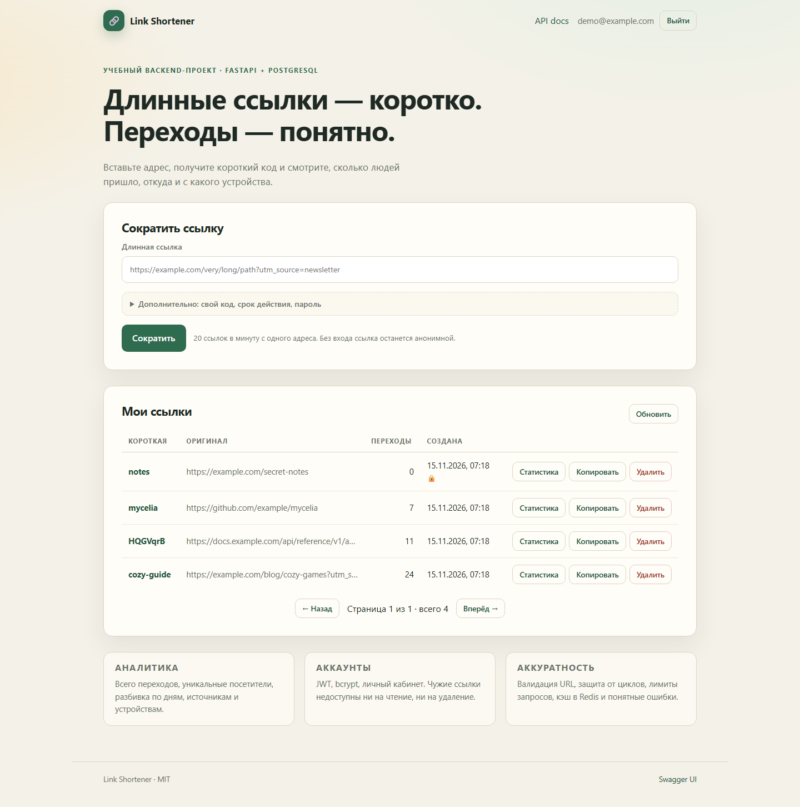
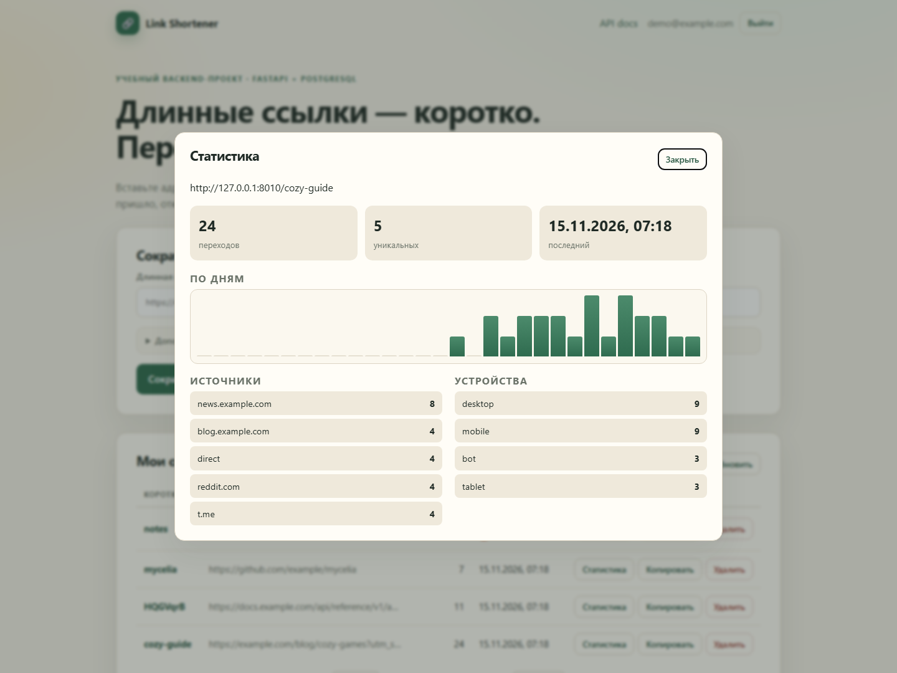
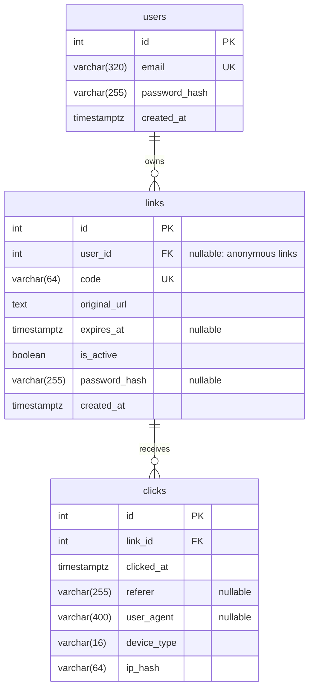

# Link Shortener

Сервис коротких ссылок с аналитикой переходов, аккаунтами и небольшим веб-дашбордом.
Учебный backend-проект для портфолио: FastAPI, PostgreSQL, SQLAlchemy + Alembic, JWT, Redis,
pytest, Docker и GitHub Actions.



## Что умеет

**Обязательная часть**

- `POST /api/links` — короткий код из 6–8 символов, уникальный и криптографически случайный.
- `GET /{code}` — редирект `302` на оригинал с записью перехода; неизвестный код → `404`.
- Валидация URL: только абсолютные `http(s)`-адреса, запрет ссылок на сам сервис (защита от циклов).
- Регистрация и вход: `POST /api/auth/register`, `POST /api/auth/login`, пароли — только bcrypt-хеш, на выходе JWT.
- Личный кабинет: список своих ссылок, удаление, статистика. Чужие ссылки недоступны (404).
- Статистика: всего переходов, уникальные посетители, переходы по дням, топ Referer, тип устройства из User-Agent.
- Swagger UI на `/docs` и OpenAPI на `/openapi.json`.

**Дополнительно**

- Свой алиас (`/my-resume`) с проверкой занятости и зарезервированных имён.
- Срок жизни ссылки: после истечения — `410 Gone`.
- Ограничение создания ссылок — 20 в минуту с одного IP (настраивается), плюс лимит на логин.
- Кэш популярных ссылок в Redis с прозрачным fallback на in-process кэш.
- QR-код ссылки: `GET /api/links/{id}/qr` (PNG).
- Защита ссылки паролем: без верного пароля редиректа нет (`401`).

## Скриншоты

| Дашборд | Статистика |
| --- | --- |
|  |  |

Лендинг со формой сокращения: [docs/landing.png](docs/landing.png).

## Стек

| Часть | Технология |
| --- | --- |
| Язык и фреймворк | Python 3.11+, FastAPI, Uvicorn |
| База данных | PostgreSQL 16, SQLAlchemy 2, Alembic |
| Кэш | Redis 7 (опционально) |
| Авторизация | JWT (PyJWT), bcrypt |
| Тесты | pytest, httpx |
| Качество кода | Ruff, Black |
| Контейнеры | Docker, docker compose |
| CI | GitHub Actions |
| Фронтенд | HTML + CSS + ванильный JS (без сборки) |

## Структура репозитория

```
link-shortener/
├── app/
│   ├── api/           # роутеры: auth, links, redirect, health
│   ├── core/          # настройки, БД, безопасность, ошибки, кэш, лимиты
│   ├── models/        # SQLAlchemy-модели User, Link, Click
│   ├── schemas/       # Pydantic-схемы запросов и ответов
│   ├── services/      # бизнес-логика: ссылки, статистика, QR, разбор запроса
│   ├── static/        # дашборд: index.html, app.js, styles.css
│   └── main.py        # фабрика приложения и ASGI-точка входа
├── migrations/        # Alembic: env.py и ревизия 0001_initial
├── tests/             # pytest: API, аналитика, безопасность, инфраструктура
├── docs/              # скриншоты для README
├── .github/workflows/ # CI: линтеры, миграции, тесты с покрытием
├── Dockerfile
├── docker-compose.yml
├── requirements.txt
├── requirements-dev.txt
├── pyproject.toml     # настройки Ruff, Black, pytest, coverage
└── .env.example
```

Поток запроса на редирект: `GET /{code}` → кэш (Redis/память) → при промахе запрос в БД →
проверка активности/срока/пароля → запись клика → `302`. Кэш инвалидируется при удалении ссылки.

## Быстрый старт: Docker

```bash
git clone <your-repo-url>
cd link-shortener
docker compose up --build
```

- Приложение: <http://localhost:8000>
- Swagger: <http://localhost:8000/docs>
- PostgreSQL: `localhost:5432`, Redis: `localhost:6379`

`docker compose` поднимает базу, Redis и приложение, применяет миграции и запускает Uvicorn.
Значения секретов по умолчанию предназначены только для локального запуска — для деплоя
создайте `.env` (см. `.env.example`) и задайте `SECRET_KEY` и `IP_HASH_PEPPER`.

## Локальный запуск

```bash
python -m venv .venv
source .venv/bin/activate          # Windows: .venv\Scripts\activate
pip install -r requirements-dev.txt

cp .env.example .env               # Windows: copy .env.example .env
# PostgreSQL и Redis можно поднять только инфраструктурой:
docker compose up -d db redis

alembic upgrade head
uvicorn app.main:app --reload
```

Если Docker недоступен, для быстрого старта достаточно SQLite:

```bash
DATABASE_URL=sqlite:///./links.db alembic upgrade head
DATABASE_URL=sqlite:///./links.db uvicorn app.main:app --reload
```

Приложение работает и без Redis: кэш и лимиты переключаются на процессы в памяти
(это видно в `GET /api/health`).

## Переменные окружения

| Переменная | По умолчанию | Назначение |
| --- | --- | --- |
| `ENVIRONMENT` | `development` | `development`, `test` или `production`. В production запрещены placeholder-секреты и требуется HTTPS `BASE_URL`. |
| `BASE_URL` | `http://localhost:8000` | Публичный адрес сервиса; из него строятся короткие ссылки. |
| `SECRET_KEY` | dev-значение | Ключ подписи JWT. Обязателен в production. |
| `JWT_ALGORITHM` | `HS256` | Алгоритм подписи. |
| `JWT_EXPIRE_MINUTES` | `10080` | Время жизни токена (7 дней). |
| `IP_HASH_PEPPER` | dev-значение | Соль для хеширования IP посетителей. |
| `DATABASE_URL` | локальный PostgreSQL | SQLAlchemy URL (`postgresql+psycopg://...` или `sqlite:///...`). |
| `REDIS_URL` | пусто | Если пусто — кэш и лимиты в памяти процесса. |
| `CACHE_TTL_SECONDS` | `300` | Время жизни записи кэша ссылки. |
| `RATE_LIMIT_CREATE_PER_MINUTE` | `20` | Лимит создания ссылок с одного IP. |
| `RATE_LIMIT_AUTH_PER_MINUTE` | `10` | Лимит попыток входа/регистрации с одного IP. |
| `SHORT_CODE_LENGTH` | `7` | Длина генерируемого кода. |
| `CORS_ORIGINS` | `[]` | Разрешённые origins (JSON-массив или список через запятую). |
| `TRUSTED_PROXY` | `false` | Доверять `X-Forwarded-For` (включайте только за своим прокси). |
| `AUTO_CREATE_TABLES` | `false` | Создать таблицы из моделей при старте (только для локальной отладки). |

## API

| Метод | Путь | Доступ | Описание |
| --- | --- | --- | --- |
| `POST` | `/api/auth/register` | все | Регистрация, возвращает JWT и пользователя |
| `POST` | `/api/auth/login` | все | Вход, возвращает JWT |
| `GET` | `/api/auth/me` | JWT | Текущий аккаунт |
| `POST` | `/api/links` | все (JWT опционально) | Создать короткую ссылку |
| `GET` | `/api/links` | JWT | Список своих ссылок с числом переходов |
| `GET` | `/api/links/{id}` | JWT | Одна своя ссылка |
| `DELETE` | `/api/links/{id}` | JWT | Удалить ссылку вместе со статистикой |
| `GET` | `/api/links/{id}/stats` | JWT | Аналитика ссылки |
| `GET` | `/api/links/{id}/qr` | все | PNG QR-код короткой ссылки |
| `GET` | `/{code}` | все | Редирект `302` |
| `GET` | `/api/health` | все | Проверка сервиса и зависимостей |

### Примеры

```bash
# Регистрация
curl -s -X POST http://localhost:8000/api/auth/register \
  -H "Content-Type: application/json" \
  -d '{"email":"demo@example.com","password":"demo-password-42"}'

# Создание ссылки со своим кодом и сроком действия
curl -s -X POST http://localhost:8000/api/links \
  -H "Authorization: Bearer $TOKEN" \
  -H "Content-Type: application/json" \
  -d '{"url":"https://example.com/long/path","custom_code":"my-resume","expires_at":"2030-01-01T00:00:00Z"}'

# Переход
curl -i http://localhost:8000/my-resume

# Статистика
curl -s http://localhost:8000/api/links/1/stats -H "Authorization: Bearer $TOKEN"
```

Анонимное создание работает без заголовка `Authorization`; такие ссылки нельзя
посмотреть или удалить позже — это осознанное решение, чтобы не хранить лишние данные.

### Формат ошибок

Все ошибки — JSON с одним и тем же конвертом. Поле `code` стабильно, `message` пригодно
для показа пользователю, `details` содержит контекст (например, список невалидных полей).

```json
{
  "error": {
    "code": "validation_error",
    "message": "The request contains invalid fields.",
    "details": [
      { "field": "url", "message": "Input should be a valid URL", "type": "url_parsing" }
    ]
  }
}
```

| Код | HTTP | Когда |
| --- | --- | --- |
| `validation_error` | 422 | Невалидное тело/параметры запроса |
| `unauthorized` / `invalid_token` / `token_expired` | 401 | Нет токена, токен испорчен или истёк |
| `invalid_credentials` | 401 | Неверная пара e-mail/пароль |
| `password_required` / `invalid_password` | 401 | Ссылка защищена паролем |
| `not_found` | 404 | Нет кода, ссылки или чужой ресурс |
| `code_taken` | 409 | Алиас уже занят |
| `reserved_code` | 400 | Алиас совпадает с маршрутом сервиса |
| `self_reference` | 400 | Ссылка ведёт на сам сервис |
| `link_expired` / `link_inactive` | 410 | Срок истёк или ссылка отключена |
| `rate_limited` | 429 | Превышен лимит запросов |
| `internal_error` | 500 | Непредвиденная ошибка (детали скрыты) |

## Модель данных



Индексы:

- `users.email` — уникальный, поиск при входе.
- `links.code` — уникальный, основа быстрого редиректа.
- `links.user_id` и `(user_id, created_at)` — личный кабинет и сортировка.
- `clicks.link_id`, `clicks.clicked_at`, `(link_id, clicked_at)` — агрегаты и выборки по дням.

Миграции создаются и применяются через Alembic:

```bash
alembic upgrade head
alembic revision --autogenerate -m "describe change"
alembic downgrade -1
```

## Как считается статистика

- **Переход** записывается после успешной проверки ссылки (и пароля, если он есть).
- **Устройство** определяется по User-Agent: `bot`, `tablet`, `mobile`, `desktop` или `other`.
- **Источник** — хост из `Referer` без `www.`; пустой Referer превращается в `direct`,
  переходы внутри сервиса — в `internal`.
- **Уникальные посетители** — `COUNT(DISTINCT ip_hash)`. Сам IP не хранится: только
  HMAC-SHA256 с секретной солью `IP_HASH_PEPPER`.
- **По дням** — последние 30 календарных дней, включая нулевые, чтобы график не «прыгал».

## Безопасность и приватность

- Пароли: bcrypt с солью. Перед хешированием пароль сворачивается в SHA-256, поэтому
  длинные пароли не обрезаются на 72 байтах.
- JWT подписывается `SECRET_KEY`, содержит `sub`, `iat`, `exp`, `type`; просроченный или
  чужой тип токена отклоняется.
- Проверка владельца: запросы к чужой ссылке возвращают `404`, а не `403`, чтобы не
  раскрывать существование ресурса.
- Ссылки на сам сервис запрещены, служебные алиасы (`api`, `docs`, `health`, ...) зарезервированы.
- Пароль защищённой ссылки хранится хешем; в БД и логах его нет.
- Секреты — только в переменных окружения; `.env` в `.gitignore`, в репозитории лежит `.env.example`.
- В production приложение не стартует с placeholder-секретами и требует `https://` в `BASE_URL`.
- `TRUSTED_PROXY=true` включает доверие `X-Forwarded-For` — включайте только за известным прокси.

## Производительность

- Тёплый редирект не обращается к БД: ссылка отдаётся из Redis или in-process кэша.
- Кэш живёт `CACHE_TTL_SECONDS` и никогда не переживает срок действия ссылки.
- Целевое время редиректа — меньше 100 мс при включённом кэше; локальные замеры дают
  единицы миллисекунд на тёплом пути.
- Списки ссылок и статистика пагинированы и опираются на индексы; N+1 в списке нет —
  количество кликов считается одним `LEFT JOIN ... GROUP BY`.

## Тесты и покрытие

```bash
pytest --cov=app --cov-report=term-missing --cov-fail-under=70
```

Покрыто: регистрация/вход/JWT, создание и валидация ссылок, редирект и запись клика,
срок действия, пароль, свои/чужие ссылки, удаление и инвалидация кэша, лимиты,
агрегация статистики (дни, источники, устройства, уникальные), QR, health, статика,
формат ошибок, кэш и rate limiter. Текущее покрытие — около 87 %.

## Линтеры

```bash
ruff check .
black --check .
```

Настройки — в `pyproject.toml` (длина строки 100, набор правил `E,F,I,UP,B,C4,SIM,RUF`).

## CI

`.github/workflows/ci.yml` на каждый push и pull request:

1. поднимает PostgreSQL 16;
2. ставит зависимости из `requirements-dev.txt`;
3. запускает `ruff check .` и `black --check .`;
4. применяет миграции `alembic upgrade head`;
5. прогоняет `pytest` с покрытием и порогом 70 %, складывает `coverage.xml` в артефакты.

## Деплой

Проект полностью контейнеризован, поэтому подходит Render, Railway, Fly.io или VPS.

1. Создайте PostgreSQL (и, по желанию, Redis) у провайдера.
2. Задайте переменные окружения: `ENVIRONMENT=production`, `BASE_URL=https://your-domain`,
   `SECRET_KEY`, `IP_HASH_PEPPER`, `DATABASE_URL`, при необходимости `REDIS_URL`.
3. Команда релиза: `alembic upgrade head`. Команда запуска: `uvicorn app.main:app --host 0.0.0.0 --port $PORT`.
4. За прокси включите `TRUSTED_PROXY=true`, чтобы статистика видела реальные IP.
5. Для Fly.io/Render достаточно `Dockerfile`; для VPS — `docker compose up -d`.

После деплоя добавьте публичную ссылку сюда:

> **Demo:** _будет добавлена после публикации_

## Ограничения и следующие шаги

- Анонимные ссылки нельзя редактировать или удалять — можно добавить одноразовый
  management-токен, если это понадобится.
- Запись клика синхронная; при высокой нагрузке её стоит вынести в очередь (RQ/Celery),
  чтобы редирект не ждал INSERT.
- Пароль защищённой ссылки передаётся query-параметром `?password=` — для строгих
  сценариев лучше заменить на POST-форму.
- Идеи для развития: определение страны по IP, проверка ссылок по блок-листу,
  кастомные домены, админ-панель, экспорт статистики в CSV.

## Лицензия

MIT — см. [LICENSE](LICENSE).
